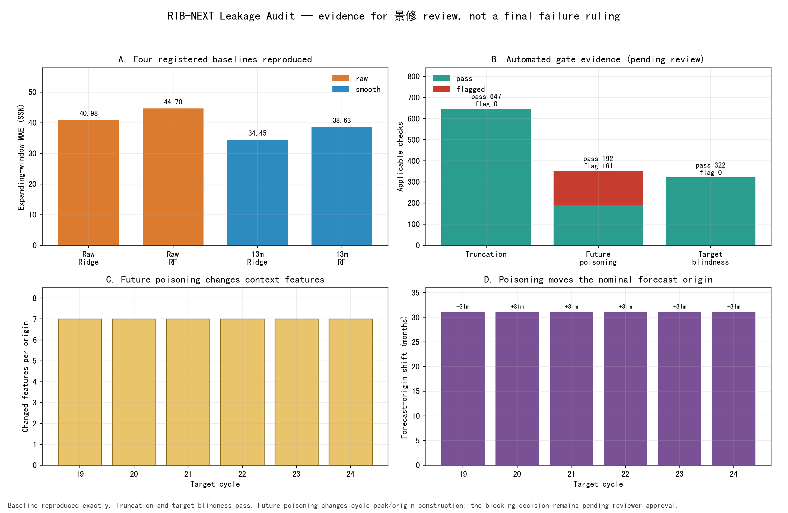
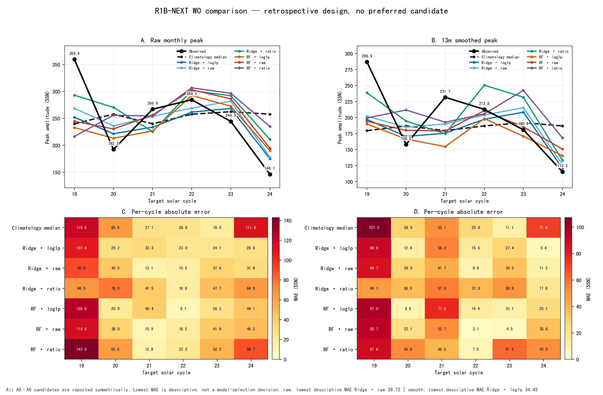

# B26M R1B-NEXT — 防泄漏审计与受控实验门

| 字段 | 内容 |
|---|---|
| 日期 | 2026-11-24 |
| 实验 ID | `B26M-R1B-NEXT` |
| 类型 | 零训练审计；无 PatchTST 重训 |
| 状态 | 审计等待景修定性；W0 性能对照已按指示完成，全部结果仅作 retrospective 描述 |
| 主验证 | 目标周期 SC19–SC24；上下文周期 SC18–SC23 |
| 种子 | RF 2019–2023；Ridge/中位数为确定性模型 |
| 环境 | RTX 5090；torch 2.8.0+cu128；Ridge/RF 使用 sklearn CPU 路径 |
| 审计脚本 | `scripts/audit_r1b_next_leakage.py` |
| 绘图脚本 | `scripts/plot_r1b_next_audit.py` |

## 结论先行

四项基线全部精确复现。截断审计 647/647、目标盲区审计 322/322、
13m 特征可用性 173/173 均通过；第一个周期没有上一周期峰，相关两项标为
`not_applicable`。

未来污染审计出现待审核问题：把原起报点之后的 SSN 改成极端值并重建上下文后，
当前周期峰时、起报日期、当前峰幅和 24 月下降量一起改变，主验证涉及的
SC19–SC24 七个上下文中每个都改变 7 个特征。未来污染使名义起报点统一后移
31 个月，因此无法在同一起报点上解释后续预测差异。

这不是我替你定性的“失败”。当前证据支持两种解释，需要你审核：

1. 若要求“起报点必须由截至该点的信息确定”，则当前构造器存在未来依赖，
   应拦截并修复；
2. 若接受“先事后确定当前周期峰，再取峰后 24 月为固定起报点”的研究设计，
   则截断测试已经证明固定起报点的输入与预测不变，未来污染只暴露的是
   样本起报点选择依赖未来周期峰值。

审计定性仍等待景修。W0 性能对照已按景修指示完成，但不据此自动给出
RF 保留/淘汰结论，也不设“主模型”或“主目标表示”。



## 基线复现

必须复现的四项均达到机器精度：

| 目标 | 模型 | 预期 expanding MAE | 复现值 | 差值 |
|---|---|---:|---:|---:|
| raw | Ridge | 40.98101811199377 | 40.98101811199377 | 0 |
| raw | RF | 44.70270853129371 | 44.70270853129370 | −7.1e−15 |
| 13m | Ridge | 34.44934928522901 | 34.44934928522901 | 0 |
| 13m | RF | 38.63317028537029 | 38.63317028537029 | 0 |

RF 五 seed 的 raw MAE 为
`46.02/43.75/46.66/44.39/42.69`；13m 为
`39.68/38.19/36.78/38.05/40.47`。原始结果可以复现，不是本次审计环境造成的
数值漂移。

## 审计结果

| 检查 | 适用检查数 | 通过 | 标记数 | 当前状态 |
|---|---:|---:|---:|---|
| truncation | 647 | 647 | 0 | 通过 |
| target blindness | 322 | 322 | 0 | 通过 |
| 13m availability / manifest | 173 | 173 | 0 | 通过；2 项结构缺失不适用 |
| future poisoning | 353 | 192 | 161 | 待景修审核 |

### A. truncation

对每个原始起报点 `t0` 删除 `date > t0` 的数据，重新运行现有
`build_cycle_context.py`。除最早两个没有完整训练历史的周期外，所有特征与
Ridge/RF/中位数预测逐元素相同。主验证 SC19–SC24 无差异。

### B. future poisoning

把 `date > t0` 的所有数值列改成 `1e9` 后重跑上下文构造器。主验证涉及
SC19–SC24 时，每个上下文都有 7 个字段变化：

```text
peak_date
origin_date
current_peak_raw
current_peak_smooth
smooth_at_origin
decline_24m
decline_pct_24m
```

变化机制位于 `build_cycle_context.py`：

```text
完整周期平滑序列 -> 整周期峰时 -> origin = peak_date + 24
```

未来极端值成为新的整周期峰后，`peak_date` 改变，`origin` 随之后移 31 个月，
并让 `smooth_at_origin` 落到原 `t0` 之后。因此这条检查证明的是
“样本起报点选择依赖未来整周期信息”，不能直接写成“固定起报点预测读取未来”。
是否构成项目必须修复的泄漏，需要你按科研设计审核。

### C. 13m availability

13m 输入特征要求中心平滑窗口完整结束于 `origin - 6m`。已逐周期记录：

```text
feature
source_columns
calculation_window
last_available_month
lag_months
required_lag_months
```

173 项适用检查全部满足；周期 1 不存在上一周期峰，相关 2 项标为
`not_applicable`。

### D. target blindness

把当前及未来周期的
`target_peak_raw/target_peak_smooth/target_peak_date/target_months_to_peak/
target_min_date/target_months_to_min` 置为 `NaN` 后，322 项适用预测检查全部不变。

## 未执行项

以下项目没有运行：

- 单特征消融；
- 峰时和谷时模型；
- R1A 接入、双峰训练、正式未来预测。

没有把“待审核”预写成最终失败。

## W0 性能对照（景修指示后补充）

raw 和 13m 分开，固定 W0，全部候选对称运行：

| ID | 模型 | 目标表示 |
|---|---|---|
| A0 | 训练折内物理量气候中位数 | physical |
| A1 | Ridge | `log1p(peak)` |
| A2 | Ridge | raw peak |
| A3 | Ridge | `next_peak/current_peak` |
| A4 | RF | `log1p(peak)` |
| A5 | RF | raw peak |
| A6 | RF | `next_peak/current_peak` |

没有指定 A2 或其他候选为主口径。运行时间约 80 秒；Ridge/RF 是 sklearn
CPU 实现，RTX 5090 对本实验没有加速作用。

本次 A0 直接使用训练折内物理量中位数；旧 `evaluate_r1b_multicycle.py`
是取 `expm1(median(log1p(target)))`，在偶数训练折中不严格等于物理中位数。
因此气候中位数从旧记录的 raw `61.63`、13m `49.53` 变为本次
raw `61.42`、13m `49.49`；Ridge/RF 数值不受影响。

### raw

| ID | MAE | 对中位数改善 | 改善周期 | 最差周期相对恶化 |
|---|---:|---:|---:|---:|
| A2 Ridge-raw | 38.72 | 36.95% | 5/6 | +108.93% |
| A1 Ridge-log1p | 40.98 | 33.27% | 4/6 | +34.15% |
| A4 RF-log1p | 44.70 | 27.21% | 3/6 | +56.45% |
| A5 RF-raw | 45.22 | 26.37% | 5/6 | +133.02% |
| A3 Ridge-ratio | 52.56 | 14.43% | 3/6 | +165.18% |
| A0 中位数 | 61.42 | 0 | 0/6 | 0 |
| A6 RF-ratio | 63.26 | −3.00% | 4/6 | +190.01% |

Ridge-raw 的平均 MAE 最低，但它在 SC23 相对气候中位数的误差恶化
108.93%；这是“平均改善、单周期崩坏”，不能直接从表中摘出最好一行就采用。
RF-log1p 的五个 seed 范围为 42.69–46.66。

### 13m

| ID | MAE | 对中位数改善 | 改善周期 | 最差周期相对恶化 |
|---|---:|---:|---:|---:|
| A1 Ridge-log1p | 34.45 | 30.39% | 4/6 | +147.05% |
| A2 Ridge-raw | 34.65 | 29.98% | 5/6 | +210.81% |
| A5 RF-raw | 35.68 | 27.92% | 5/6 | +1.05% |
| A4 RF-log1p | 38.63 | 21.94% | 5/6 | +47.73% |
| A3 Ridge-ratio | 41.33 | 16.49% | 2/6 | +358.05% |
| A0 中位数 | 49.49 | 0 | 0/6 | 0 |
| A6 RF-ratio | 50.49 | −2.02% | 4/6 | +454.08% |

13m 的 Ridge-log1p 平均 MAE 最低，但 SC23 明显恶化；RF-raw 的平均 MAE
略高 1.23 SSN，最差周期只恶化 1.05%，是当前表里最平稳的候选。是否因此保留
RF 仍由景修审核，报告不自动下结论。



证据：

- `analysis/r1b_next/target_representation_summary.csv`
- `analysis/r1b_next/r1b_next_seed_summary.csv`
- `analysis/r1b_next/r1b_next_per_cycle.csv`
- `analysis/r1b_next/r1b_next_predictions.csv`
- `analysis/r1b_next/r1b_next_performance.json`
- `analysis/r1b_next/r1b_next_comparison.png/.pdf`

### 完整观测轮廓图（非模型预测）

R1B/Ridge/RF 只输出周期峰幅，不生成逐月轮廓。为直接查看完整历史形态，另用
原始 SILSO 月均 SSN 绘制：

- `analysis/sunspot_history/sunspot_full_history.png/.pdf`：
  1749–2026 完整月均曲线 + SC19–SC25 放大；
- `analysis/sunspot_history/sunspot_cycle_contours.png/.pdf`：
  SC1–SC25 按周期极小值对齐的完整轮廓；
- `analysis/sunspot_history/sunspot_recent_cycle_contours.png/.pdf`：
  SC19–SC25 的清晰叠加轮廓。

这些图只表示观测数据，不是 PatchTST 或 Ridge/RF 的预测曲线。

## 请景修审核的问题

1. 当前研究是否要求每个预测样本的起报点在起报时刻即可确定？
2. 若要求可确定，`build_cycle_context.py` 必须改为只用 `date <= t0` 的数据
   识别当前周期边界与峰时，再生成特征；
3. 若接受当前“峰后 24 月” retrospective 设计，需要把该限制写进 R1B
   结论边界，不得把 SC26 结果表述为实时可复现预测；
4. 审核通过前，不启动 W0 目标表示实验，也不给出 RF 保留结论。

## 产物

- `analysis/r1b_next/leakage_audit.csv`
- `analysis/r1b_next/leakage_audit_summary.json`
- `analysis/r1b_next/feature_manifest.csv`
- `analysis/r1b_next/baseline_predictions.csv`
- `analysis/r1b_next/r1b_next_audit.png`
- `analysis/r1b_next/r1b_next_audit.pdf`
- `analysis/r1b_next/r1b_next_comparison.png`
- `analysis/r1b_next/r1b_next_comparison.pdf`
- `scripts/audit_r1b_next_leakage.py`
- `scripts/plot_r1b_next_audit.py`
- `scripts/evaluate_r1b_next.py`
- `scripts/plot_r1b_next.py`
